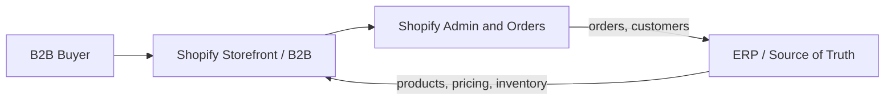

# Output Templates — Shopify B2B Advisor

Copy-pasteable deliverable structure. Fill brackets; delete what doesn't apply.

---

## 1. Requirements analysis

> **Business model.** [Pure B2B / B2B + D2C / wholesale arm; scale: companies, buyers, geos.]
>
> **Commercial summary.** [Pricing model, catalog visibility, payment terms, key processes.]

| Area | Requirement | Priority | Constraint / note |
| --- | --- | --- | --- |
| Accounts | [ ] | Must/Should/Nice | [ ] |
| Pricing | [ ] | [ ] | [ ] |
| Catalog | [ ] | [ ] | [ ] |
| Payments/terms | [ ] | [ ] | [ ] |
| Workflow | [ ] | [ ] | [ ] |
| Integration | [ ] | [ ] | [ ] |
| UX | [ ] | [ ] | [ ] |

> **MVP scope.** [The must-haves required to launch.]

---

## 2. Recommended architecture

> **Platform tier.** [native B2B on the current plan vs a plan upgrade or apps/custom work — with the reasoning and tradeoffs.]
>
> **Account model.** [Company accounts vs customer accounts; buyers/roles/locations.]
>
> **Pricing & catalog.** [Price-list structure, gating, currencies.]
>
> **Payments & terms.** [Net terms, methods, tax handling.]
>
> **Integration.** [Source of truth per data type; sync method and direction.]

Architecture overview:

---

## 3. Feature matrix

| Requirement | Native | App | Custom | Not feasible | Notes / dependency |
| --- | --- | --- | --- | --- | --- |
| Company accounts | [ ] | | | | Basic/Grow/Advanced/Plus; confirm eligibility |
| Direct company/location catalogs | [ ] | [ ] | | | Native direct assignment requires Plus; distinguish shared market catalogs |
| Shared B2B market catalogs | [ ] | [ ] | | | Basic/Grow/Advanced: 3 active assignments total and new Markets required; Plus: unlimited |
| Gated catalog | [ ] | [ ] | | | [ ] |
| Payment terms (Net 30) | [ ] | [ ] | | | [ ] |
| Quote workflow | | [ ] | [ ] | | [ ] |
| Order approval | | [ ] | [ ] | | [ ] |
| Sales-rep ordering | | [ ] | [ ] | | [ ] |
| Bulk / quick order | | [ ] | [ ] | | [ ] |
| ERP integration | | [ ] | [ ] | | [ ] |

---

## 4. Implementation roadmap

| Phase | Goal | Scope | Depends on |
| --- | --- | --- | --- |
| Phase 1 — Foundation | Plan/setup, accounts, catalog | [account model, plan decision, data model] | [ ] |
| Phase 2 — Core B2B | Pricing, gated catalog, ordering | [price lists, gating, checkout] | Phase 1 |
| Phase 3 — Workflow & integration | Terms, quotes/approval, ERP sync | [terms, integration, rep tools] | Phase 2 |
| Phase 4 — Optimization | UX, reorder, reporting, scale | [quick order, portal polish] | Phase 3 |

---

## 5. Risk assessment

| Risk | Type | Likelihood | Impact | Mitigation |
| --- | --- | --- | --- | --- |
| Platform fit (required feature/plan limits) | Platform | [ ] | [ ] | Confirm plan early; map workarounds |
| ERP sync conflicts/failures | Integration | [ ] | [ ] | Define source of truth; staged sync; alerting |
| Data migration errors | Data | [ ] | [ ] | Stage + validate; reversible; confirm before live |
| Process change resistance | Org | [ ] | [ ] | Train reps/buyers; phased rollout |
| Scope creep / cost overrun | Delivery | [ ] | [ ] | Lock MVP; phase the rest |

Plan evidence: [official comparison](https://help.shopify.com/en/manual/b2b/getting-started/plan-features), checked 2026-10-11. Recheck for the merchant and record the source/date per capability; native B2B is not universally Plus-only.
